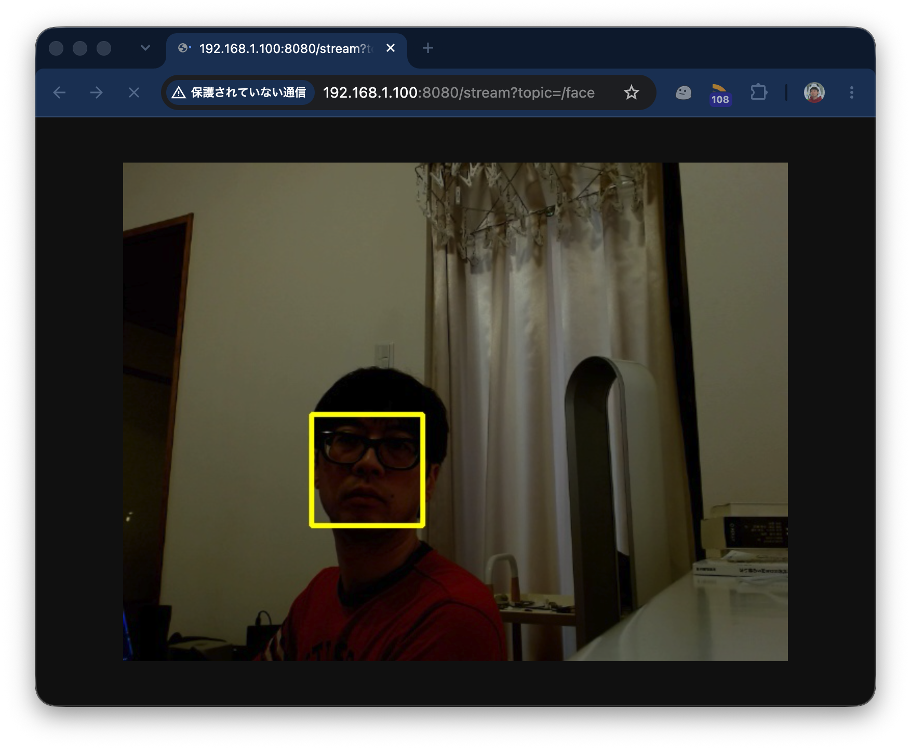

<!-- footer: 栃木県産業技術センター様 -->

# ROS 2入門

千葉工業大学 上田 隆一

<p style="font-size:50%">
This work is licensed under a <a rel="license" href="http://creativecommons.org/licenses/by-sa/4.0/">Creative Commons Attribution-ShareAlike 4.0 International License</a>.
<a rel="license" href="http://creativecommons.org/licenses/by-sa/4.0/">
</a>
</p>

---

<!-- paginate: true -->

## 本日の内容

- まずこれをやる
    - https://ryuichiueda.github.io/slides_marp/robosys2025/lesson8.html
- そのあとWebカメラを使ってみる

---

## WebカメラをROS 2環境で使う

- 内容
    - GitHub上パッケージの利用について

---

## GitHub上にあるパッケージ利用

- ROSのパッケージが多く存在
    - 用途に合わせて使うとプログラミングが不要なことも（[例](https://www.youtube.com/watch?v=jS5_a9BW2zI)）
    - 多くはGitHubのリポジトリor apt経由でインストール可能
- 有名なパッケージ
    - ros-perception/gmapping（ROS 1）, googlecartographer/cartographer_ros（ROS 1）: SLAM
    - ros-planning/navigation2: ナビゲーションメタパッケージ
    - ros-planning/moveit2 : マニピュレータの制御
    - RobotWebTools/web_video_server: USBカメラをウェブへ（今から使用）


---

## パッケージのダウンロード方法

- リポジトリのページからワークスペースへ
    - 左図の「Code」でURLをコピーし，srcディレクトリで`git clone`を実行
        ```bash
        $ git clone URL
        ```
- 関連するパッケージのインストール
    - git cloneあるいは次のコマンドで
        ```bash
        $ cd ~/ros2_ws
        $ sudo rosdep update
        $ sudo rosdep install -i 
        --from-path src
        --rosdistro jazzy -y
        ```
    - `colcon build`


---

## ネット上のソフトウェアを使うときの考え方

「タダだラッキー」ではない

- オープンソース文化
    - コードをシェアしてフィードバック
    - 論文とも通じる知識の共有方法
        - コードは人類の共有資産（ハードと違ってコピー可能）
    - 人のコードからさらに良いものを作っていく
- コミュニティー文化
    - 会社や団体の壁をなくして情報を共有


---

## 注意すべきこと

- ライセンス、著作権
    - 詳しくなると自由度が増す
    - 参考: 講師の大学での講義動画
        - ロボットシステム学第9回（ソフトウェアライセンスとクリエイティブ・コモンズ）
            - https://youtu.be/scg0kewfA74
- よく使われるライセンス
    - GPL、BSD、MIT、クリエイティブコモンズ


---

## 課題1: GitHub経由でのパッケージインストール

- web_video_serverをインストールしてみましょう
    - カメラ画像をブラウザに表示するパッケージ
- インストール
    ```bash
    $ cd ~/ros2_ws/src
    $ git clone -b ros2 https://github.com/RobotWebTools/web_video_server.git
    $ cd ~/ros2_ws
    $ sudo rosdep update
    $ sudo rosdep install -i --from-path src --rosdistro jazzy -y
    $ colcon build
    $ sudo apt install ros-jazzy-usb-cam python3-pydantic
    ```
    - 補足: 2行目のgit clone -b ros2 ...
        - ros2の「ブランチ」をダウンロードという意味

---

### 立ち上げ

- カメラのノードの立ち上げ
    ```bash
    $ sudo chmod 666 /dev/video*
    $ ros2 run usb_cam usb_cam_node_exe --ros-args --remap video_device:=/dev/video0
    ```
- web_video_serverの立ち上げ（別端末） 
    ```bash
    $ ros2 run web_video_server web_video_server
    ```
- ブラウザでURL`http://<IPアドレス>:<ポート番号>`を指定
$\qquad\qquad\qquad\qquad\qquad$


---

### カメラノードからのデータの確認

- トピック一覧を見ると様々な形式で画像が配信されている

<div class="columns">
<div>

```bash
$ ros2 topic list
/camera_info
/image_raw
/image_raw/compressed
/image_raw/compressedDepth
/image_raw/theora
/image_raw/zstd
/parameter_events
/rosout
```

</div>

<div>

```bash
$ ros2 topic echo /image_raw | less

header:
  stamp:
    sec: 1792474449
    nanosec: 556611000
  frame_id: default_cam
height: 480
width: 640
encoding: yuv422_yuy2
is_bigendian: 0
step: 1280
data:
- 17
- 128
・・・   #ひたすら画素値が並ぶ
```

</div>

</div>

---

## 課題2: 画像処理の体験

- お題: ウェブカメラを使って顔の検出ソフトを作成

---

### 手順（1/2）

- OpenCVのインストール
    - おそらくインストール済み
    - 以下インストールされてないときのメモ
        ```bash
        $ sudo apt install python3-opencv
        $ sudo apt install ros-jazzy-cv-bridge  #たぶんインストール済み
        $ sudo apt install ros-jazzy-image-transport-plugins #たぶんインストール済み
- パッケージの作成
    ```bash
    $ cd ~/ros2_ws/src
    $ ros2 pkg create imgproc --build-type ament_python
    ### 前半の知識を活かして設定 ###
    ```

---

### 手順（2/2）

- ノードの作成
    - [コードの例](https://gist.github.com/ryuichiueda/eb0e560587d39db5352b43873ba2ac5b)（顔の検出）
        - コードの意味はGoogleなどが答えてくれます
        - `setup.py`などの設定とファイル名などを合わせましょう
- 動作確認
    - web_video_serverから見ると右図のように見えます



---

## まとめ

- ROS 2プログラミングを体験
    - 他の人と共通な部分はダウンロードと設定で済む
    - 最後の表示などは自身（or LLMエージェント）でコーディング
