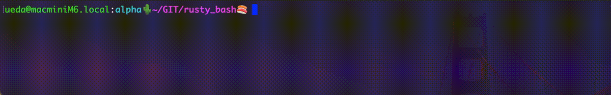
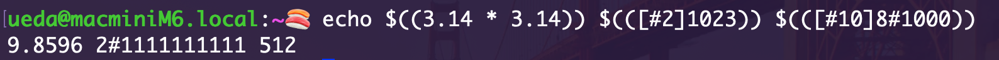
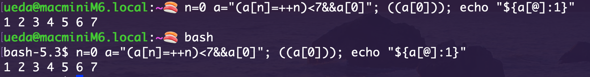
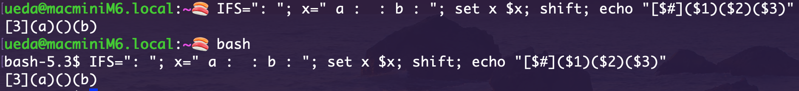

<!-- footer: findyイベント -->

# 自作シェル活動について

シェル芸人　上田 隆一
（世を忍ぶ仮の姿: 千葉工業大学未来ロボティクス学科教授）

© 上田隆一, 2026

---

<!-- paginate: true -->

## お前だれだ

- 「シェル芸」という言葉を言い出した張本人
    - ご迷惑をおかけしております
- 今日話する自作シェルについて長期連載
    - 次の1月号で最終回（第50回）
- 2ヶ月に1回「シェル芸勉強会」開催
    - 次の第78回は12/26（土）を予定（来てね）
- 合法シノギとして大学に（真面目に）勤務
    - 最近の活動: 生成モデル/言語モデル/ロボット基盤モデルとかを論文を追っかけながら講義

---

## 本日の本題: 自作シェル

- [Rusty Bash（愛称: 寿司シェル）](https://github.com/shellgei/rusty_bash)という名前で作ってます
    - <form action="https://www.google.com/search" method="get" target="_blank">
           <input type="text" name="q" value="寿司シェル GitHub" required>
           <button type="submit">検索</button>
        </form>
- どんなシェルか: Bashのクローン
    - 3条項BSDライセンス
- 現在の完成度
    - bash/git-completionが動く（下図。たぶん世界にそんなにない）
    - 普段から無意識に使ってます（端末のデフォルトのシェルに）

---

## なんで作ってるの？（カスタマイズのため・・・ではありません）

- 私とカスタマイズ: デフォルト野郎なので会の趣旨的には追放必至
    - Linux、mac、Windows全部使うのでいちいち設定できね
    - 指が極端に短いのでVimで`esc`を打たないようにする程度
- 真の目的
    - Bashのコードややこしい /  Rustの勉強 / ボケ防止（いまだにVim+手）
    - ダニング=クルーガー効果の回避
        - 「お前ほんとにシェルに詳しいんか？」と自問するため
        - 手作りの温もりのある27,244行・・・

客観的に見てマゾ的行為でしかない

---

## とはいえ、寿司シェルでBashと実装を変えた部分

- トリプルタブ補完: 3回タブを押すと矢印キーで補完する文字を選べる
    - この例で「`switch`」と「`alpha`」を選んでいるところ

    - 特に日本語のファイルやディレクトリを選ぶのに便利
- 算術式展開: 浮動小数点の計算 / n進数を出力（Zshから）
    

ピンと来たら使って（手伝って）みてください

---

## どこまでBashに似せているのか

- こういうのとか
    - 
- こういうのとか
    - 

正直、自分でも説明できません

---

## 自作のすすめ（こういう場合はどうぞ）

- 仕組みを知りたい（分解の次のフェーズ）
- 筋トレのように脳を鍛えたい
    - ゲームのような反射的なものでなく長時間のパズルとして
- カスタマイズしたい + 既存のものに勝てそう
- 仕事で作っているものがデカすぎて関わってる人数が多すぎる
    - 作り手というより自身が作るための部品になっちゃってるこんな世の中じゃ
- 自分でもなぜかよく分からないけど作らないと成仏できない

---

## 自作のすすめ・・・をしないケース

- 仕事で余裕がない
    - 寝不足になってまでやることではない
- 勉強が目的ではないのに車輪を再発明
    - ライセンスを変えるとか高速、安定したものを作るとか、外向けに何かを変えたいところ
    - 自分の知っていることの枠外に出たいところ
- 自分が便利なシェルを作りたい
    - 結局BashやZshの機能が欲しくなって使用断念
    - シェルの変な文法に文句を言う人がいますが、人類はここ数十年、ファイルやプロセスの操作のための代替の言語を編み出せていない

---

## まとめ

- 寿司シェルを作っている
    - LLM時代に作る意味はあるか$\rightarrow$ある。余計にある。
        - 料理とか編み物とか自分で作るのは楽しい
        - プログラミング=仕事という考え方は会社の中だけ
            - ついったうるさい
- 自作するものがシェルである必要はない
    - 自身の専門領域か、その周辺のなにかを息抜きに作るのがオススメ
