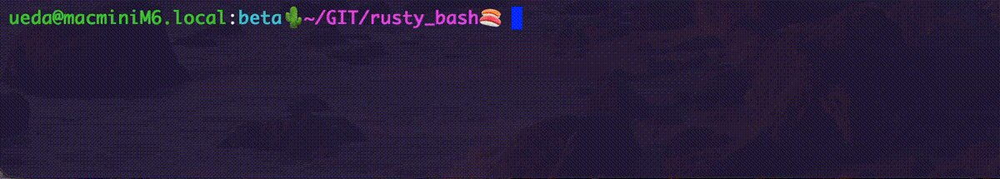

<!-- footer: findy -->

# 自作シェル活動について

シェル芸人（千葉工業大学未来ロボティクス学科教授兼担） 上田 隆一

© 上田隆一, 2026

---

<!-- paginate: true -->

## お前だれだ

- 「シェル芸」という言葉を世間に吹聴した張本人
    - ご迷惑をおかけしております
- 今日話する自作シェルについて長期連載
    - 次の1月号で最終回（第50回）
- 2ヶ月に1回「シェル芸勉強会」開催
    - 次の第78回は12/26（土）を予定（来てね）
- 合法シノギとして大学に（真面目に）勤務
    - 最近の活動: 生成/言語/ロボット基盤モデルとかを論文を追っかけながら講義

---

## 本日の本題: 自作シェル

- [Rusty Bash（愛称: 寿司シェル）](https://github.com/shellgei/rusty_bash)という名前で作ってます
    - 「寿司シェル GitHub」で検索
- どんなシェルか: Bashのクローン
    - 3条項BSDライセンス
- 現在の完成度
    - bash-completionやgit-completionが動く（下図。たぶん世界にそんなにない）
    - 普段から意識せず使ってます（端末が立ち上げるシェルに）

---

## なんで作ってるの？

- カスタマイズのため・・・ではありません
    - 私とカスタマイズ（話題がない）
        - だいたいなんでもデフォルトで使用
        - 指が極端に短いのでVimでescを打たないようにする程度
            - 身体的な特徴以外は自分を道具に合わせる
- 目的
    - Bashのコードややこしい
    - Rustの勉強
    - ボケ防止（いまだにVim+手）
    - ダニング=クルーガー効果の回避

---

## ダニング=クルーガー効果

- ある特定の分野において能力の限られた人が、自分の能力を過大評価してしまう認知バイアス（Wikipediaより）
    - ついったでうるさい人だいたいこれ
    - LLMエージェントのおかげで更に世の中が地獄
- いやまて、自分もそうなってないか？
    - シェル芸のオッサンであってシェルの専門家ではないが、いつのまにかシェル関係の原稿依頼を受けてしまうように（よくない）
    - どうするか？$\rightarrow$作れればたぶん専門家（諸説あり）

---

## とはいえ、寿司シェルでBashと実装を変えた部分

- トリプルタブ補完: 3回タブを押すと矢印キーで補完する文字を選べる
    - この例で「`alpha`」を選んでいるところ

    - 日本語のファイルやディレクトリを選ぶのに便利なので
- 算術式展開
    - n進数を出力（Zshから）
    - 浮動小数点の計算

ピンと来たら使って（手伝って）みてください

---

## まとめ

- 寿司シェルを作っている
    - LLM時代に作る意味はあるか$\rightarrow$ある。余計にある。
        - これまでは作るために知識がある人が重宝された
        - これからは作れるくらいに知識がある人が重宝される（$\simeq$医師）
- 自作するものがシェルである必要はない
    - 研究者の立場からは、ユーザーが増えない限りは独創性・有用性・学術性が薄い行為なので勧められない
    - 自身の専門領域のなにかを息抜きに作るのがオススメ
