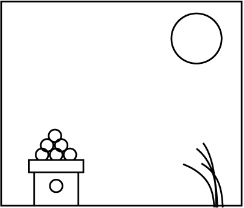
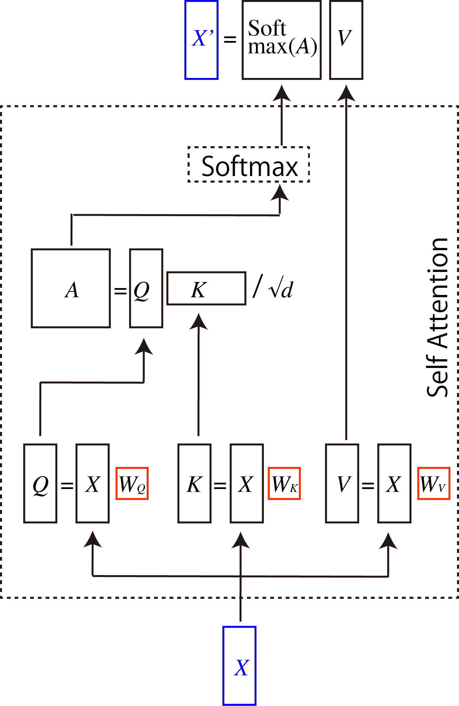
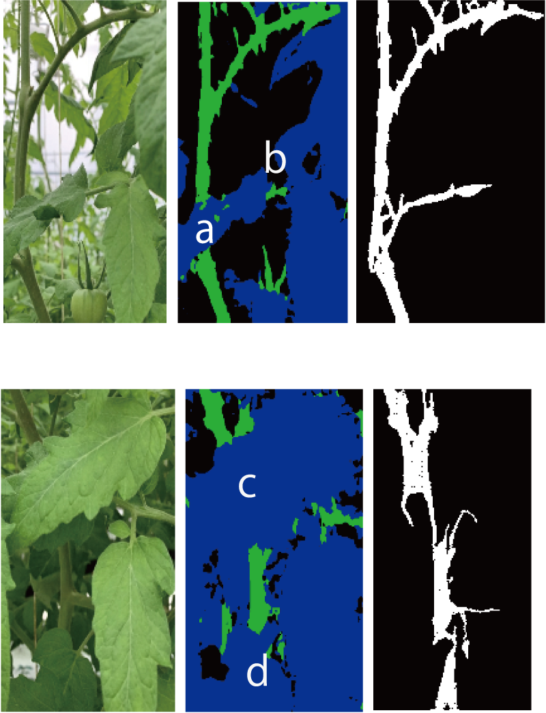
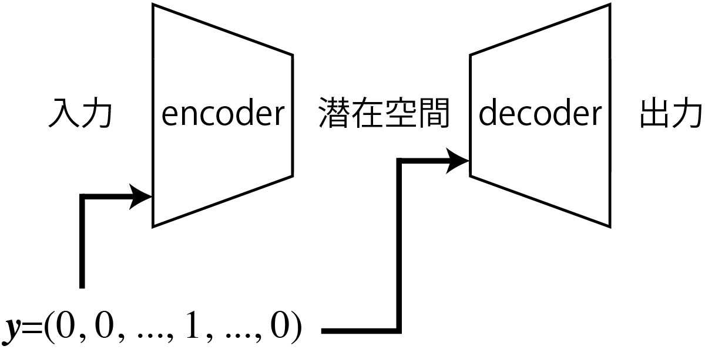
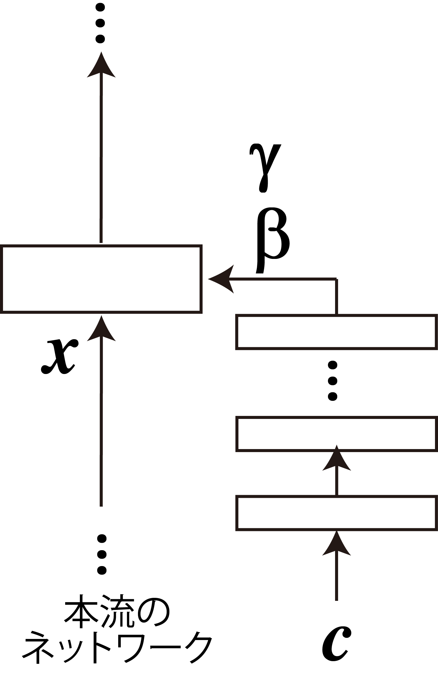

<!-- footer: "ロボットビジョン第4.5回" -->

# ロボットビジョン

## 第5回: 想起・生成の制御

千葉工業大学 上田 隆一

 

This work is licensed under a [Creative Commons Attribution-ShareAlike 4.0 International License](https://creativecommons.org/licenses/by-sa/4.0/).

---

<!-- paginate: true -->

## 内容

- オリジナルのDDPMの要素について補足
- 生成モデルの出力をコントロールしたい
    - 条件付きGAN
    - 条件付きVAE
    - 分類器なしガイダンス

---

## オリジナルのDDPMの要素について補足

- 構造: [この図](https://vizuara.substack.com/i/203080645/17-why-u-nets-became-the-classic-denoiser)が分かりやすい
- ポイント
    - U-Net状
    - 畳み込み層と残差接続層
    - 時刻の「Sin/Cos Time Embedding (=sinusoidal embedding)」（後述）
    - 「Self Attention（自己注意機構）」（後述）
- 今はU-Netでないものも使われる（何回か先の講義で）

---

### sinusoidal embedding、正弦波エンコーディング（[図](https://www.m1ke.org/p/transformer%E3%81%AEpositional-encoding%E3%81%AE%E8%A7%A3%E9%87%88/)）

- $\boldsymbol{p}_t = (p_{t,0} \quad p_{t,1} \quad \cdots \quad p_{t,D})^\top$
   - $p_{t,i} = \begin{cases}
        \sin ( t \beta^{-i/D})  & (i\%2 = 0) \\
        \cos ( t \beta^{-(i-1)/D}) & (i\%2 = 1) 
\end{cases}$
        - $D$はベクトルの次元（前ページの図では64）、$\beta$の値は$10,000$など
- 例（$D=5, \beta=10000$）
    - $\boldsymbol{p}_0 = (0.00 \ \ \ \ \ \   \ 1.00 \ \ 0.00  \ \ 1.00 \ \ 0.00)^\top$
    - $\boldsymbol{p}_1 = (0.91 \ \ -0.42 \ \ 0.00  \ \ 1.00 \ \ 0.00)^\top$
    - $\boldsymbol{p}_2 = (0.14 \ \ -0.99 \ \ 0.00  \ \ 1.00 \ \ 0.00)^\top$
    - $\cdots$
- 性質: 内積$p_i\cdot p_{i+j}$の値が
    - 相対位置$j$だけに依存（$j=0$$\rightarrow$ $2$、$j=1$、$1.54$、$j=2$$\rightarrow$ $0.58$、$j=3$$\rightarrow$ $0.01$, $j=4$$\rightarrow$ $0.35$）
    - $j$の値が大きくなると増減するものの減少していく

---

### DDPMでのsinusoidal embeddingの使い方

- 手順
    - sinusoidal embeddingで作ったベクトルを作る
    - 全結合層に通して各残差接続のところで足す
        - 詳細は未調査（だれかー！）
- DDPM関係ないけど補足
    - 文章の解析の場合、単語の位置（語順）を表すのに使われる
    - 様々な時刻・位置のエンコーディング方法がある
        - 参考: https://qiita.com/AITLND/items/cbc9441285b6eaa65c11

---

### 自己注意機構（役割）

- 問題を解きやすいように入力に強弱をつけて出力する層
    - 作文の処理や画像処理で使用される
    - 語順や場所の遠いところ同士を関連づけ可能
        - CNNには苦手なこと
- 例（例なのであからさまに分かりやすいもの）
    - 問題:「次の文で掘られたのは何？『私は彼のために穴を掘りました。』」
        - 質問から遠い「穴」を私、彼よりも強調
    - 問題: 右図は何の絵？
        - 3隅にある団子、笹、月が強調される

---

### 自己注意機構の入出力

- 入力: $d$次元の横ベクトルを長さ$n$個だけ積んだ行列$X$
    - 先述の図のDDPMの場合（U-Netの谷底で使用）
        - $d$次元: チャネルの数（$128$）
        - 「$n$個の入力」: 各画素
        （$14\times 14= 196$個）
- 出力: 同じ大きさの行列$X'$
    - 問題が解きやすい値に変化

- $X$の形
    - 下の表がそのまま行列に
    - 画素は1列に並べる
        ||ch1|ch2|...|ch128|
        |:---:|:---:|:---:|:---:|:---:|
        |画素(1,1)|||...||
        |画素(1,2)|||...||
        |画素(1,3)|||...||
        |...|||...||
        |画素(14,14)|||...||

---

### 自己注意機構のパラメータと計算

- パラメータ: $d\times d$次元の3つの行列$W_Q,W_K, W_V$
    - 「$Q, K, V$」: それぞれクエリ、キー、バリュー
- 計算
    - $Q= XW_Q$、$K= XW_K$、$V= XW_V$
        （いずれも$n$行$d$列の行列に）
    - $A = QK^\top / \sqrt{d}$を計算（$n$行$n$列行列に）
    - 出力: $X'=$Softmax$(A)V$
        - Softmaxは$A$の行単位で適用
        - $V$の各要素をSoftmax$(A)$で重み付け

$n$個のデータの行列中の位置に関係なく重み付け可能

---

### 例・補足

- 言葉を反映した画像の注意の例（先取り）
    - https://wazalabo.com/vlm-attention-visualization.html
- マルチヘッド注意機構（細かいことは未調査）
    - $Q, K, V$を$h$分割してあとから結果を重み付けの行列$W_0$にかけて連結
    - それぞれの分割（ヘッド）で別の切り口で各データの関連性を計算
    - $W_0$の分だけパラメータが増える

---

## 生成モデルの出力のコントロール

- 前回紹介したモデルのデコーダは何が出力されるか分からない
    - 特にDDPM、FM

どうやってコントロールしましょう？

---

### 条件付きGAN（Conditional GAN、CGAN）[[Mirza+ 2014]](https://arxiv.org/abs/1411.1784)

- GANの生成ネットワークはランダムにデータを出力するだけ
    - 何を出力するかコントロールしたい
- 条件付きGAN [図](https://www.researchgate.net/figure/Architecture-of-the-Conditional-adversarial-net_fig3_366684170)
    - 生成ネットワークに何を作って欲しいかラベルで指示
        - データのもとになるベクトル$\boldsymbol{z}$と共にラベル$\boldsymbol{y}$を入力
            - $\boldsymbol{y}$はワンホットベクトル
                - $\boldsymbol{y} = (0 \ \ 0 \ \dots 1 \dots \ 0)$という形で対応するラベルを$1$に
    - 識別ネットワークにも、生成ネットワークの出力と共に$\boldsymbol{y}$を入力
        - 条件$\boldsymbol{y}$に合った生成データか判定

---

### pix2pix

- CGANの一種とみなせる
- pix2pix[[Isora 2016]](https://arxiv.org/abs/1611.07004)（構造は論文のFigure 2に）
    - 生成ネットワーク: 入力にノイズではなく画像を入力し、画像を出力させる
        - U-Netがベース
        - 入力をX、出力をYとしましょう
    - 識別ネットワーク: XとYのペア、あるいはXと対応する学習用画像Y'のペアを入力して真贋を識別
    $\rightarrow$画像を変換するように学習
- どんなことができるか
    - 線画をカラーの絵や写真のように（図: [[Isora 2016]](https://arxiv.org/abs/1611.07004)）
    - 葉に隠れた枝をつなぐ[[三上2022]](https://www.jstage.jst.go.jp/article/jrsj/40/2/40_40_143/_article/-char/ja)

---

### 条件つき変分オートエンコーダ （Conditional VAE、CVAE）

- CGANと同様、エンコーダとデコーダにラベルも入力
    - デコーダはラベルにしたがってデータを生成できる
- 入力の識別情報が、潜在空間内で必要なくなる
    - [VAEとCVAEの分布の比較の例](https://towardsdatascience.com/conditional-variational-autoencoders-for-text-to-image-generation-1996da9cefcb/)
    - 画像の生成の場合、画像の描き方に関する情報が潜在空間内に分布
    $\rightarrow$より出力にバリエーション

---

### CVAEの数理

- VAEの確率モデルの条件にラベル$\boldsymbol{y}$が入るだけで計算は基本的に変わらない
    - エンコーダ: $\boldsymbol{z} \sim P_\boldsymbol{\theta}(\boldsymbol{x}|\boldsymbol{y})$
    - デコーダ: $\boldsymbol{x} \sim P_\boldsymbol{\phi}(\boldsymbol{z}|\boldsymbol{y})$
    - $\mathcal{L}(\boldsymbol{\phi}, \boldsymbol{\theta} | \boldsymbol{x}, \boldsymbol{y}) = \dfrac{1}{2}\sum_{j=1}^m ( 1 + \log \sigma_j^2 - \mu_j^2 - \sigma_j^2 )$
    $\qquad\qquad\qquad\qquad+\dfrac{1}{L}\sum_{\ell=1}^L \log P_\boldsymbol{\theta}(\boldsymbol{x} | \boldsymbol{z}^{(\ell)}, \boldsymbol{y})$

---

## 拡散モデルの誘導

拡散モデルでも出力をコントロールしたい

- adaptive $\circ\circ$ normalization
- 生成したいものが生成されるようにノイズを誘導
    - 分類器あり
    - 分類器なし（こっちが主流）

---

### FiLM / adaptive $\circ\circ$ normalization 

- FiLM（Feature-wise Linear Modulation）[[Perez 2017]](https://arxiv.org/abs/1709.07871)
    - 入力$\boldsymbol{c}$（ラベルやその他入力）に応じて強弱をつける
    - 式: $\boldsymbol{y} = \boldsymbol{\gamma}(\boldsymbol{c}) \odot \boldsymbol{x} + \boldsymbol{\beta}(\boldsymbol{c})$
- adaptive $\circ\circ$ normalization（Ada$\circ\circ$）
    - $\boldsymbol{x}$を正則化してFiLM
        - AdaBN: 適応的バッチ正則化
        - AdaGN: 適応的グループ正則化[[Dhariwal 2021]](https://arxiv.org/abs/2105.05233)
            - グループ正則化: ひとつの入力$\boldsymbol{x}$内の要素ををいくつかのグループに分けてそれぞれで正則化
        - AdaLN: 適応的レイヤー正則化
            - レイヤー正則化: ひとつの入力$\boldsymbol{x}$内の要素を正則化（グループ分けしない）

---

### 分類器ありガイダンス[[Dhariwal 2021]](https://arxiv.org/abs/2105.05233): 方法・アイデア

- 学習済みのデコーダ$p_\boldsymbol{\theta}(\boldsymbol{x}_i | \boldsymbol{x}_{i+1})$を準備
- 識別器$p_\boldsymbol{\phi}(y| \boldsymbol{x}_i)$を（難しいけど）作る
    - 雑音画像$\boldsymbol{x}_i$からラベル$y$を分類
- デコーダ$p_\boldsymbol{\theta}(\boldsymbol{x}_i | \boldsymbol{x}_{i+1})$の出力を識別器を使ってずらす
    - $y$のラベルを持つ画像の分布の方向へ誘導
- ガイダンスの例: 論文の図3
    - ただし、[[Dhariwal 2021]](https://arxiv.org/abs/2105.05233)では様々な分類器ありガイダンス方法が試されており（読む時注意）、この例はそのひとつ

---

### ずらし方の導出（1/2）

- 逆拡散過程をラベル$y$で条件付けしてベイズの定理で分類器とデコーダに分解
    - $p(\boldsymbol{x}_i | \boldsymbol{x}_{i+1}, y) 
    = \eta p(y| \boldsymbol{x}_i, \boldsymbol{x}_{i+1})p(\boldsymbol{x}_i | \boldsymbol{x}_{i+1})
    = \eta p_\boldsymbol{\phi}(y| \boldsymbol{x}_i)p_\boldsymbol{\theta}(\boldsymbol{x}_i | \boldsymbol{x}_{i+1})$
    $\Longrightarrow \log p(\boldsymbol{x}_i | \boldsymbol{x}_{i+1}, y) =
    \log p_\boldsymbol{\phi}(y| \boldsymbol{x}_i) + \log p_\boldsymbol{\theta}(\boldsymbol{x}_i | \boldsymbol{x}_{i+1}) +$定数
- 分類器の分布の式の対数をテイラー展開
    - $\log p_\boldsymbol{\phi}(y | \boldsymbol{x}_{i}) = \log p_\boldsymbol{\phi}(y | \boldsymbol{x}_{i})|_{\boldsymbol{x}_{i}=\boldsymbol{\mu}}+(\boldsymbol{x}_{i}- \boldsymbol{\mu})^\top \nabla_{\boldsymbol{x}_{i}} \log p_\boldsymbol{\phi}(y | \boldsymbol{x}_{i})|_{\boldsymbol{x}_{i}=\boldsymbol{\mu}}$
    $\ \quad\qquad\qquad= (\boldsymbol{x}_{i}- \boldsymbol{\mu})^\top \boldsymbol{g}+$定数
        - $\boldsymbol{\mu}$: $\boldsymbol{x}_{i}$の分布の平均値（縦ベクトル。デコーダで出力可能）
        - $\boldsymbol{g} = \nabla_{\boldsymbol{x}_{i}} \log p_\boldsymbol{\phi}(y | \boldsymbol{x}_{i})|_{\boldsymbol{x}_{i}=\boldsymbol{\mu}}$: $\boldsymbol{\mu}$において$y$に対して識別器が出す確率の対数の勾配ベクトル
            - 誤差逆伝播に使う各層のヤコビ行列の積から$y$に対応する特定の列 or 行を取り出すと計算できる（たぶん。ここらへん未調査）

---

### ずらし方の導出（2/2）

- $\log p(\boldsymbol{x}_i | \boldsymbol{x}_{i+1}, y) =
    \log p_\boldsymbol{\phi}(y| \boldsymbol{x}_i) + \log p_\boldsymbol{\theta}(\boldsymbol{x}_i | \boldsymbol{x}_{i+1}) +$定数
  $\qquad\qquad\qquad\qquad= 
  (\boldsymbol{x}_i - \boldsymbol{\mu})^\top \boldsymbol{g}
  -\frac{1}{2}(\boldsymbol{x}_i - \boldsymbol{\mu})^\top\Sigma^{-1}(\boldsymbol{x}_i - \boldsymbol{\mu})
  +$定数
  $\qquad\qquad\qquad\qquad= -\frac{1}{2}(\boldsymbol{x}_i - \boldsymbol{\mu} - \Sigma \boldsymbol{g})^\top\Sigma^{-1}(\boldsymbol{x}_i - \boldsymbol{\mu} - \Sigma \boldsymbol{g})+$定数
  $\qquad\qquad\qquad\qquad= \log \mathcal{N}(\boldsymbol{x}_{i} | \boldsymbol{\mu} + \Sigma \boldsymbol{g}, \Sigma)$+定数
- $\Longrightarrow p(\boldsymbol{x}_i | \boldsymbol{x}_{i+1}, y) = \mathcal{N}(\boldsymbol{x}_{i} | \boldsymbol{\mu} + \Sigma \boldsymbol{g}, \Sigma)$
    - つまり、ずらす量は$\Sigma \boldsymbol{g}$
        - ラベル$y$の確率が上がる方向にずらす
    - DDPMのデコーダでは$\Sigma$は時刻に対して固定

---

### 具体的な生成アルゴリズム

1. ノイズ画像$\boldsymbol{x}_T$をえらぶ
2. $i=T$から$i=0$まで雑音除去
    - $\boldsymbol{\mu}, \Sigma \longleftarrow \boldsymbol{\mu}_\boldsymbol{\theta}(\boldsymbol{x}_{i+1}), \Sigma_\boldsymbol{\theta}(\boldsymbol{x}_{i+1})$（普通のデコーダの出力）
    - $\boldsymbol{g} \longleftarrow \nabla_{\boldsymbol{x}_{i}}\log p_\boldsymbol{\phi}(y|\boldsymbol{x}_{i})$
    - $\boldsymbol{x}_i \sim \mathcal{N}[\boldsymbol{\mu} + s\Sigma \boldsymbol{g},\Sigma]$
        - $s$: スケール（論文では$0.0, 1.0, 10.0$などが試されている）
            - $s=0.0$だとラベルが無効に
            - $s=1.0$でも実用上は弱い
- 補足: スケールが入った推定
    - $\hat p_{\boldsymbol{\theta}}(\boldsymbol{x}|y) = \eta p_\boldsymbol{\theta}(\boldsymbol{x})p_\boldsymbol{\phi}(y|\boldsymbol{x})^s$という分布の勾配を使っていることに（分類器なしガイダンスでこの式を使う）

---

### ノイズ予測版（「だいたいこんな感じ」くらいで書いているので参考程度に）

- DDPMでなくDDIMを想定
- 逆拡散過程をラベル$y$で条件付けしてベイズの定理で分類器とデコーダに分解
    - $p(\boldsymbol{\varepsilon} | \boldsymbol{x}_{i}, y) 
    = \eta p(y| \boldsymbol{x}_i, \boldsymbol{\varepsilon})p(\boldsymbol{x}_i | \boldsymbol{\varepsilon})
    = \eta p_\boldsymbol{\phi}(y| \boldsymbol{x}_i)p_\boldsymbol{\theta}(\boldsymbol{x}_i)$
    $\Longrightarrow \log p(\boldsymbol{\varepsilon} | \boldsymbol{x}_{i}, y) =
    \log p_\boldsymbol{\phi}(y| \boldsymbol{x}_i) + \log p_\boldsymbol{\theta}(\boldsymbol{x}_i) +$定数
- 勾配（雑音の変化量）の関係に変換
    - $\nabla_{{\boldsymbol{x}}_i} \log p(\boldsymbol{\varepsilon} | \boldsymbol{x}_{i}, y) = \nabla_{{\boldsymbol{x}_i}} \log p_\boldsymbol{\phi}(y| \boldsymbol{x}_i) + \nabla_{\boldsymbol{x}_i}\log p_\boldsymbol{\theta}(\boldsymbol{x}_i)$
        - ここでデコーダ$\boldsymbol{\varepsilon}_\boldsymbol{\theta}$をラベルに基づいたもの$\hat{\boldsymbol{\varepsilon}}_\boldsymbol{\theta}$に修正することを考えると
            - $\nabla_{\boldsymbol{x}_i}\log p_{\boldsymbol{\theta}}(\boldsymbol{x}_i) = - \frac{1}{\sqrt{1- \bar{\alpha}_i}}\boldsymbol{\varepsilon}_\boldsymbol{\theta}(\boldsymbol{x}_i)$
            - $\nabla_{{\boldsymbol{x}}_i} \log p(\boldsymbol{\varepsilon} | \boldsymbol{x}_{i}, y)= - \frac{1}{\sqrt{1- \bar{\alpha}_i}}\hat{\boldsymbol{\varepsilon}}_\boldsymbol{\theta}(\boldsymbol{x}_i)$

$\Longrightarrow \hat{\boldsymbol{\varepsilon}}_\boldsymbol{\theta}(\boldsymbol{x}_i) = \boldsymbol{\varepsilon}_\boldsymbol{\theta}(\boldsymbol{x}_i) - \sqrt{1- \bar\alpha_i}\boldsymbol{g}$

---

### 具体的な生成アルゴリズム

1. ノイズ画像$\boldsymbol{x}_T$をえらぶ
2. $i=T$から$i=0$まで雑音除去
    - $\boldsymbol{g} \longleftarrow \nabla_{\boldsymbol{x}_{i+1}}\log p_\boldsymbol{\phi}(y|\boldsymbol{x}_{i+1})$
    - $\hat{\boldsymbol{\varepsilon}} \longleftarrow \boldsymbol{\varepsilon}_\boldsymbol{\theta}(\boldsymbol{x}_{i+1}) - \sqrt{1-\bar\alpha_i}\boldsymbol{g}$
    - $\boldsymbol{x}_i \longleftarrow \sqrt{\bar\alpha_{i}}\dfrac{\boldsymbol{x}_{i+1} - \sqrt{1- \bar\alpha_{i+1}}\hat{\boldsymbol{\varepsilon}}}{\sqrt{\bar\alpha_{i+1}}} + \sqrt{1-\bar\alpha_i}\hat{\boldsymbol{\varepsilon}}$

---

### ここまでのまとめ

- ラベルの与え方 
    - そのままワンホットベクトルを

---

### 分類器なしガイダンス[[Ho 2022]](https://arxiv.org/abs/2207.12598): アイデア

- 1つのデコーダに条件付きと条件なしの学習を両方させると、分類器が不要になる
- 方法（講師の雑な解釈）
    - さっき出てきたスケールつきの分類器ありガイダンスの式を用意
        - $\hat p_{\boldsymbol{\theta}}(\boldsymbol{x}|\boldsymbol{c}) = \eta p_\boldsymbol{\theta}(\boldsymbol{x})p_\boldsymbol{\phi}(\boldsymbol{c}|\boldsymbol{x})^{w+1}$（$y$を$\boldsymbol{c}$、$s$を$w+1$に変更）
    - この式を上の式に代入
        - $p_\boldsymbol{\phi}(\boldsymbol{c}|\boldsymbol{x}) = p(\boldsymbol{x}|\boldsymbol{c})p(\boldsymbol{c})/p(\boldsymbol{x}) = \eta p(\boldsymbol{x}|\boldsymbol{c})p(\boldsymbol{x}) = \eta p_\boldsymbol{\theta}(\boldsymbol{x}|\boldsymbol{c})p_\boldsymbol{\theta}(\boldsymbol{x})$
            - 最後に$\boldsymbol{\theta}$をつけたのはデコーダに置き換えるという意味
            - $\boldsymbol{c}$が外からやってくる定数と仮定して$p(\boldsymbol{c})$を$\eta$に（珍しい変換）
    - $\Longrightarrow \hat p_{\boldsymbol{\theta}}(\boldsymbol{x}|\boldsymbol{c}) = \eta p_\boldsymbol{\theta}(\boldsymbol{x})^{-w}p_\boldsymbol{\theta}(\boldsymbol{x}|\boldsymbol{c})^{w+1}$
        - 対数にして勾配をとると$\hat{\boldsymbol{\varepsilon}}_{\boldsymbol{\theta}}(\boldsymbol{x},\boldsymbol{c}) = (1+w)\boldsymbol{\varepsilon}_\boldsymbol{\theta}(\boldsymbol{x},\boldsymbol{c}) - w \boldsymbol{\varepsilon}_\boldsymbol{\theta}(\boldsymbol{x})$
            - $\boldsymbol{c}$は条件だけど、ここでは関数$\boldsymbol{\varepsilon}$の引数として表記

---

### 分類器なしガイダンス: 方法

- ラベル（あるいは何らかのベクトル）を入力として受け付ける学習前の
デコーダ$\boldsymbol{\varepsilon}_\boldsymbol{\theta}(\boldsymbol{x}_t,\boldsymbol{c})$を用意
    - （今更ながら）時刻$t$も引数だけど省略
- 学習
    - $\boldsymbol{c}$と画像のペアを訓練データとして用意
    - たまに（$10$や$20$\%程度）$\boldsymbol{c}$の代わりにゼロベクトルを与えて学習
        - $\boldsymbol{\varepsilon}_\boldsymbol{\theta}(\boldsymbol{x}_t,\boldsymbol{c})$に$\boldsymbol{\varepsilon}_\boldsymbol{\theta}(\boldsymbol{x}_t,\boldsymbol{0})$$=\boldsymbol{\varepsilon}_\boldsymbol{\theta}(\boldsymbol{x})$も学習させる
- 前ページ最後の式$\hat{\boldsymbol{\varepsilon}}_{\boldsymbol{\theta}}(\boldsymbol{x},\boldsymbol{c}) = (1+w)\boldsymbol{\varepsilon}_\boldsymbol{\theta}(\boldsymbol{x},\boldsymbol{c}) - w \boldsymbol{\varepsilon}_\boldsymbol{\theta}(\boldsymbol{x},\boldsymbol{0})$でガイダンス

---

