<!-- footer: "ロボットビジョン第6回" -->

# ロボットビジョン

## 第6回: 埋め込みと文脈の付加

千葉工業大学 上田 隆一

 

This work is licensed under a [Creative Commons Attribution-ShareAlike 4.0 International License](https://creativecommons.org/licenses/by-sa/4.0/).

---

<!-- paginate: true -->

## 今日やること

- 自然言語と人工ニューラルネットワーク
    - 言葉で画像や処理内容を理解するモデルの存在
- 扱うもの
- Word2vec
- Transformer

---

## Word2vec[[Mikolov2013]](https://arxiv.org/abs/1301.3781)

- 単語をベクトル表現するためのモデル群や枠組み
- Word2vecで作られたベクトル表現が言語を扱うANNの入力に

---

### 単語のベクトル表現（単語の埋め込み、分散表現）

- 近い単語は似たベクトルに
    - 例（適当。上記のように次元はもっと必要）
        - おじさん$= (0.9, 0.32, 0.07)$
        - おばさん$= (0.7, 0.55, 0.08)$
        - 不動産$= (0.1, 0.05, 0.88)$
    - 類似度が内積で計算できる
        - おじさん$\cdot$おばさん$=0.77$
        - おじさん$\cdot$不動産$=0.07$
    - 次元を大きくすると、様々な切り口で類似度を計算可能
- 分散表現（埋め込み表現）: 上記のような単語のベクトル表現
- 埋め込み: 分散表現を作ること

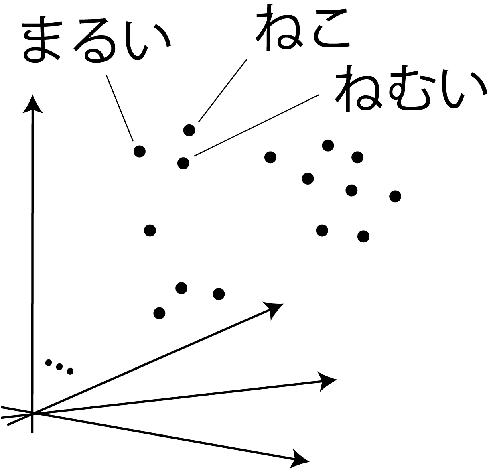

---

### 埋め込みとこれまでの内容の関係

- 分散表現の空間=潜在空間
    - 入力をエンコーダで別の空間に写像
    - （Word2vecの場合は確率は考えない）
- 疑問
    - 単語同士の類似度を潜在空間に作り出すには？
        - エンコーダ側の構造は？
        - デコーダ側の構造は？
        - 何を学習させる？

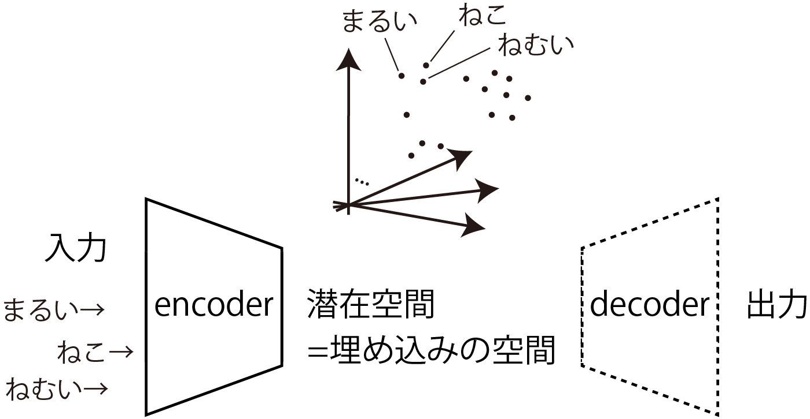

---

### 分布仮説（distributional hypothesis）

- "You shall know a word by the company it keeps!" [[Firth1957]](https://cs.brown.edu/courses/csci2952d/readings/lecture1-firth.pdf)
    - 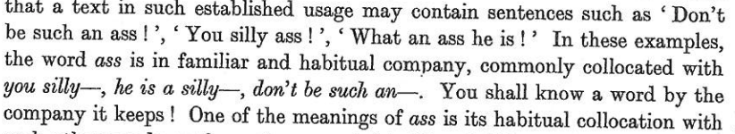
        - ass言い過ぎ
    - ある単語の意味は周辺の単語が担っているということ
- つまり、ある単語のベクトルの値は、文の前後の単語から決めるとよい
（仮説が正しいならば）
    - [Mikolov2013]では、この性質を利用した分散表現の作成方法が
    2つ示されている
 

順に見ていきましょう

---

### 埋め込みの方法1: skip-gram

- 右図の構造のANNを準備
    - アフィン層2つとソフトマックス層
- 受け付ける入力: $\boldsymbol{v} = (0\ 0\ \cdots\ 1\ 0\ \cdots\ 0)$
    - ある単語について、その単語に対応する要素が$1$になったone-hotベクトル
    - 単語の種類だけ次元がある
- アフィン層間のベクトル$\boldsymbol{x}$: 数百〜数千次元
    - これが分散表現に
- 出力: 入力と同じ次元のベクトル
    - 各単語に対応する確率（学習対象）

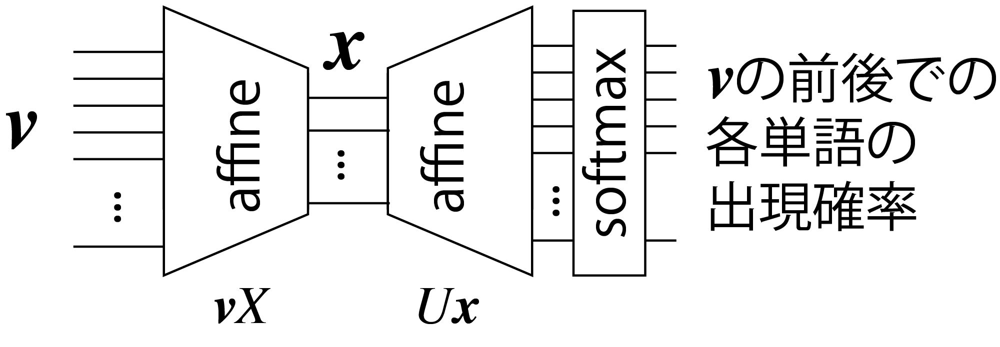

---

### skip-gramの学習

- ある単語$w$のone-hotベクトル$\boldsymbol{v}_{w}$に対し、ある範囲内に別の単語$\boldsymbol{w}'$がある確率を学習
    - たくさんの文献から訓練データを作成
    - 単語間の関係を反映した埋め込みが可能
- $X$の各行が分散表現に
    - $X = [\boldsymbol{x}_{w_1}\ \boldsymbol{x}_{w_2}\ \dots\ \boldsymbol{x}_{w_N}]^\top$
    - $\boldsymbol{x}_{w_i} = \boldsymbol{v}_{w_i}X$
        - ある単語$w_i$のone-hotベクトル$\boldsymbol{v}_{w_i}$を入力すると、$\boldsymbol{x}_{w_i}$が得られる

---

### 埋め込みの方法2: Continuous Bag-of-Words（CBoW）

- 下図のANNに次の学習をさせる
    - 文のなかの単語を隠して、周辺の$C$個の単語から隠した単語を当てる
        - 例: "Tokyo Skytree is the __ tower in Japan."（$C=2$）
        $\rightarrow$ is、the、tower、inからtallestを推測させる
- ANNの入出力
    - 入力: 前後$C$範囲内の単語のone-hotベクトルを平均したもの
    - 出力: 各単語について、隠された文字である確率を記録したもの
        - skip-gramと同じく次元は単語の種類の数
- skip-gramと同様、$X$の各行が潜在表現のベクトルに

$\qquad\qquad\qquad\qquad$

---

## Transformer

---

### 埋め込みができればコンピュータが文章を認識する?

・・・ことはできない

- 最尤な単語をskip-gramで予想して並べていけばそれっぽい文は作れるけど、たぶん無意味な文ができる
    - [マルコフ連鎖ジェネレータ](https://lorem.sabigara.com/?source=ginga-tetsudo&format=plain&sentence_count=5)のようなもの
- 単純な埋め込みには限界
    - 語順に関する情報は、完全にはない
    - 文脈依存な情報を持っていない
        - 同音異義語に1つのベクトル$\rightarrow$区別してない
            - 例: チンチラ（げっ歯類にも猫にもいる）

どうしましょう？

<a href="https://commons.wikimedia.org/wiki/Chinchilla_lanigera#/media/File:Chinchilla_lanigera_(Wroclaw_zoo)-2.JPG">写真上 by Guérin Nicolas（CC BY-SA 3.0）</a>
<a href="https://commons.wikimedia.org/wiki/File:Chinchilla_cat_(3228221937).jpg">写真下 by allen watkin（CC BY-SA 2.0）</a>

---

### どうすればいいか?

- 埋め込みに語順と文脈の情報を付加してやるとよい
    - 潜在表現のベクトルに位置情報を付加
    - さらに注意機構で文脈を考慮
- Transformer[[Vaswani2017]](https://arxiv.org/abs/1706.03762)で考案された
    - これらの仕組みで既存のANNを凌駕
        - Transformerの概略と入力を説明してから順に説明していきます

---

### オリジナル（翻訳用途）のTransformer

- Googleが開発
    - [使ってみましょう](https://translate.google.co.jp/?hl=ja&sl=en&tl=ja&op=translate)（たぶん当時と違うものだけど）
- 正体: 右のような構造のANN
    - エンコーダ（左側）とデコーダ（右側）で構成
- 画像にも応用されている
    - Vision Transformer（ViT）
- その他言葉を扱うもので新しいものは、だいたいこれの応用

[画像: CC-BY-4.0 by dvgodoy](https://commons.wikimedia.org/wiki/File:Transformer,_full_architecture.png)

---

### 翻訳Transformerの使われ方

- 例: 日本語「牛丼が食べたい」の英訳
- エンコーダ側に日本語の文を入力
- デコーダ側に次のように作りかけの文を何度も入力
    - 入力:「」-> 出力: 「I」
    - 入力:「I」-> 出力: 「want」
    - 入力:「I want」-> 出力: 「to」
    - ・・・

デコーダ側は1単語ずつ推論（実際はingなどのサブワード単位でスペースなども推論で出力）

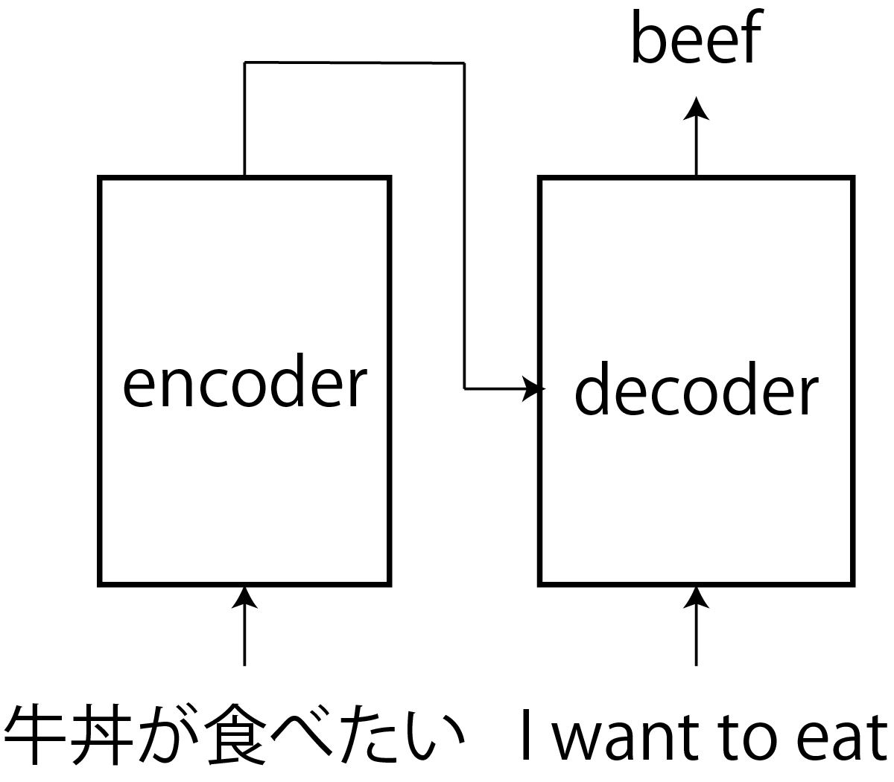

---

### エンコーダ

- 入力: サブワードの埋め込み表現の列
    - サブワード: ingなど単語の部品まで分解した語
    - 文の順番に並べて入力
- 出力: 文脈に応じて値が変化した埋め込み表現の列
    - 列のなかのサブワードの順番や数は不変
    - 接続先で問題が解きやすいようにベクトルが変化
- 構造（入力が受ける加工）
    - 入り口で位置埋め込みされる
    - その後「正則化->自己注意機構->正則化->全結合層」という$N$個のユニットを通る
    - 最後に正則化

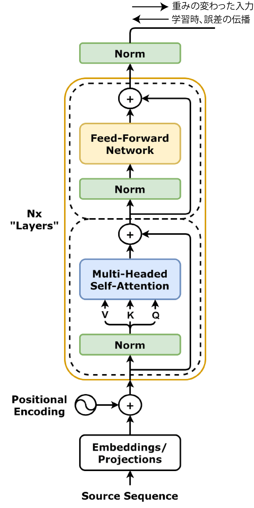

---

### 入力と位置情報の追加

- 位置情報を付加する前の入力: $E=[\boldsymbol{e}_{w_1}\ \boldsymbol{e}_{w_2}\ \dots\ \boldsymbol{e}_{w_N}]^\top$
    - 右の例では省略されているが`<EOS>`（文の終わり）などの特殊なトークンも入力として並べる
- 付加後の入力: $H_\text{enc} = \sqrt{D}E + P$
   - $D$: $\boldsymbol{e}$の次元
- 位置情報の加え方（おさらい）
   - $P = [\boldsymbol{p}_1 \ \boldsymbol{p}_2 \ \dots \ \boldsymbol{p}_N]^\top$
        - $\boldsymbol{p}_t = (p_{t,0} \quad p_{t,1} \quad \cdots \quad p_{t,D})^\top$
           - $p_{t,i} = \begin{cases}
                \sin ( t \beta^{-i/D})  & (i\%2 = 0) \\
                \cos ( t \beta^{-(i-1)/D}) & (i\%2 = 1) 
\end{cases}$

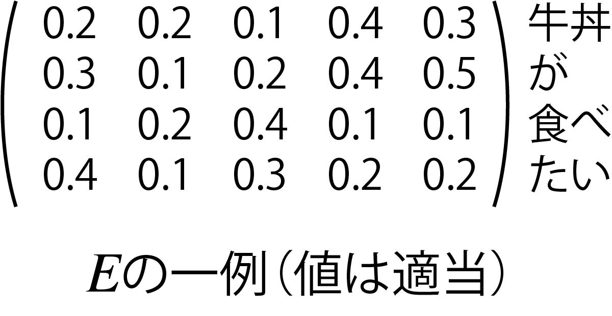

---

### 層正則化（layer normalization。既出）

- 図中に3つある「Norm」
- 方法
    - 各サブワードのベクトル$\boldsymbol{h}=(h_1 \ h_2 \ \cdots \ h_D)^\top$の元の合計と分散を正規化して元ごとの影響力を揃える
    - 各元ごとに拡大率$\gamma_i$、シフト量$\beta_i$を学習して影響力を調整
- 補足: オリジナルのモデルと右図では位置が違う
    - オリジナル: 青、黄色の層のあと

---

### 自己注意機構とフィードフォワード層（全結合層）

- 自己注意機構
    - 注目すべきサブワードを強調
    - おさらい
        - 出力: $X'=$Softmax$(QK^\top / \sqrt{D})V$
            - $Q= XW_Q$、$K= XW_K$、$V= XW_V$
- フィードフォワード層
    - 要はアフィン+活性化関数層
        - 自己注意機構を通った文が通される
        - 非線形な活性化関数（オリジナルはReLU）を通して特徴をより強調
- 図のようにスキップ接続を使用
    - 深いので使用しないと学習無理

---

### その他補足

- 図に描かれていないがドロップアウト層を何ヶ所かに使用
    - ドロップアウト: 学習の単位（バッチ）ごとに一定割合のニューロンを働かなくする処理
        - 特定のニューロンに特定の役割を背負わせないで過学習を防止
- 活性化関数として、ReLUの代わりにGELU（Gaussian Error Linear Unit）が使用されることも
    - $h(x) = x\cdot \frac{1}{2}\big\{ 1 + \text{erf}(x/\sqrt{2})\big\}$
        - $\text{erf}(a) = \frac{2}{\sqrt{\pi}}\int_0^a e^{-t^2}\text{d}t$
    - 素直に微分可能

（[画像by Ringdongdang CC BY-SA 4.0](https://commons.wikimedia.org/wiki/File:ReLU_and_GELU.svg)）

---

### エンコーダのまとめ

- 次のような挙動を実現するように学習される
    - 文をトークンのベクトルを並べて位置の情報を加えた行列$H_\text{enc}$を受け取る
    - 自己注意機構と全結合層で$H_\text{enc}$中の各ベクトルを文脈にあわせて操作
        - ↑繰り返し
    - 文脈の反映された$H'_\text{enc}$を出力

---

### デコーダ（とデーコーダの先）

- 本体は緑の枠内
    - 翻訳途中の文に対応する行列$H_\text{dec}$を受け取り
    - 横から$H_\text{enc}'$が入る
- デコーダの先に具体的な仕事をするためのANNが接続される
    - 翻訳の場合は次の単語を予測するための全結合層
    - デコーダは仕事がしやすいように$H_\text{dec}$を$H'_\text{dec}$に変更

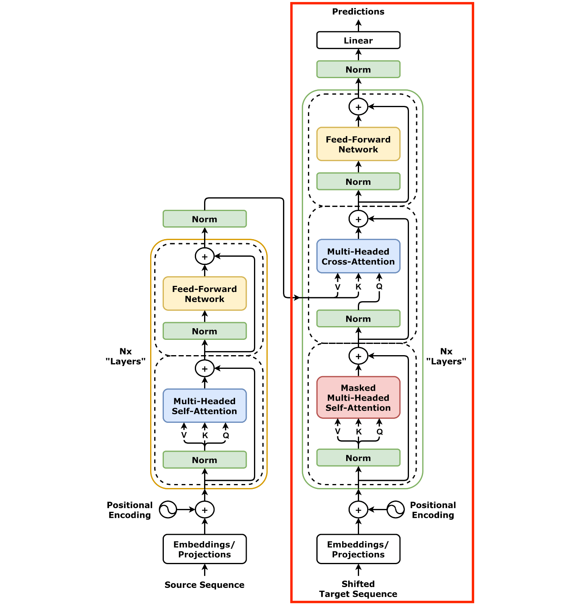

---

### デコーダの本体

- （自己注意機構+交差注意機構+フィードフォワード層）$\times N$
- 自己注意機構（マスク付き自己注意機構）の役割
    - 翻訳途中の文の文脈を考慮して$H_\text{dec}$を操作
    - 図中の「Masked」
        - 学習の際に答えを隠す役割
- 交差注意機構（次ページ）
    - エンコーダの出力$H'_\text{enc}$を反映

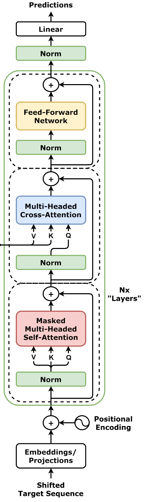

---

### 交差注意機構

- デコーダの入力（途中までの翻訳文）をクエリとしてエンコーダの値を重み付けして出力
    - 途中までの翻訳文より元の全文のほうが重要っぽい
- 次のようにクエリ、キー、バリューの行列を作成
    - $Q= W_\text{Q}H_\text{dec}$
    - $K= W_\text{K}H_\text{enc}'$$\leftarrow$エンコーダの出力を使用
    - $V= W_\text{V}H_\text{enc}'$$\leftarrow$同上
- 出力: Softmax$\Big(\dfrac{QK^\top}{\sqrt{D}}\Big)V$

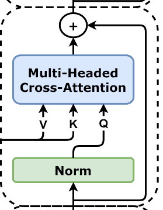

---

### デコーダの先

- 全結合層でデーコーダの入力の次の単語を予測
    - skip-gramのように学習可能
    - 出力は各トークンが次にくる確率
        - トークンの種類だけ次元がある
- この部分の誤差を逆伝播することで学習が進行
    - 損失関数: 交差エントロピー
        - $-\sum_{i=1}^{N_\text{token}} P(\boldsymbol{e}_i)\log Q(\boldsymbol{e}_i)$
        $= - \log Q(\boldsymbol{e}^*)$
            - $P$が正解で$Q$が出力
            - $\boldsymbol{e}^*$: 正解のトークン

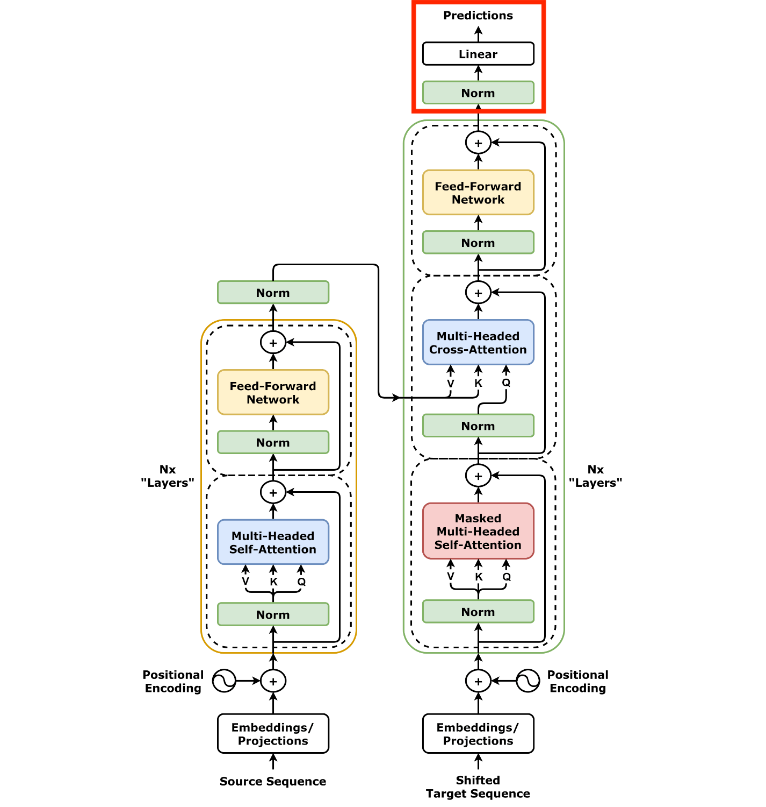

---

### Transformer（翻訳用途）の構造のまとめ

- 結局どんな問題を解いていたのか？$\rightarrow$こういう確率の問題
    - $\Pr\{$次に来る単語$|$翻訳前の文章$,\quad\!\!\!\!$翻訳途中の文章$\}$
- Transformerの工夫
    - 翻訳前の文章、翻訳途中の文章に位置情報を付加
    - 文脈の考慮
        - 翻訳前の文章から注目すべき箇所を自己注意機構で
        発見して埋め込みに反映（エンコーダ）
        - 翻訳途中の文章を自己注意機構にかけて文脈を考慮した上で、
        さらにエンコーダからの文脈を交差注意機構で反映

---

## Transformerの応用

- 感情分析
- 文章生成

（より高度なものは次回以降）

---

### Transformerエンコーダによる感情分析

- Transformerを分類タスクに応用することを考える
    - 入力: 文（例: 今日、100円を拾いました。）
    - 出力: 感情（楽しい、嬉しい、悲しいなど）
- エンコーダで構成可能[[中井2025]](https://gihyo.jp/book/2025/978-4-297-14972-7)
    - 文の先頭に`[CLS]`というトークン（クラストークン）を加えて学習
    - 学習すると出力のクラストークンに分析のための情報が集まるように
- Vision Transformerによる物体認識は基本この構造がこのまま使える（次回）

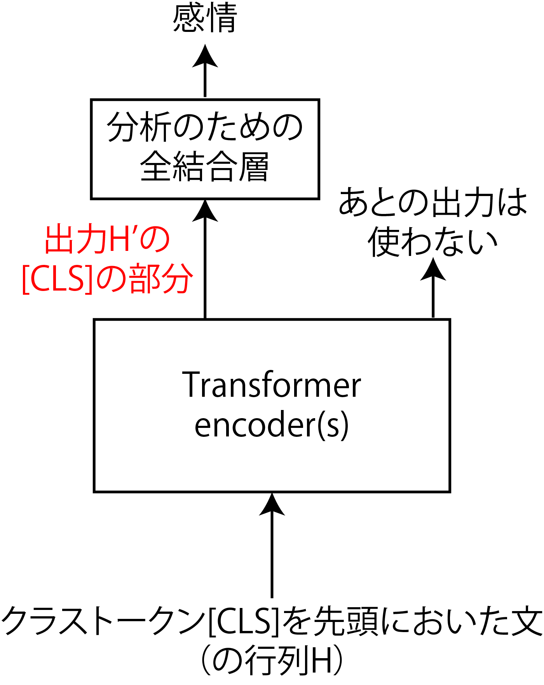

---

### Transformerエンコーダによる文章生成

こちらも[[中井2025]](https://gihyo.jp/book/2025/978-4-297-14972-7)から（4.3.2項）

- 右図の構成で訓練すると文章をランダムに生成していける
    - 文脈が考慮されているので、かなり自然な出力が得られる（内容が正しい保証はなにもなし）
- GPTはデコーダを使用（次々回以降にやります）

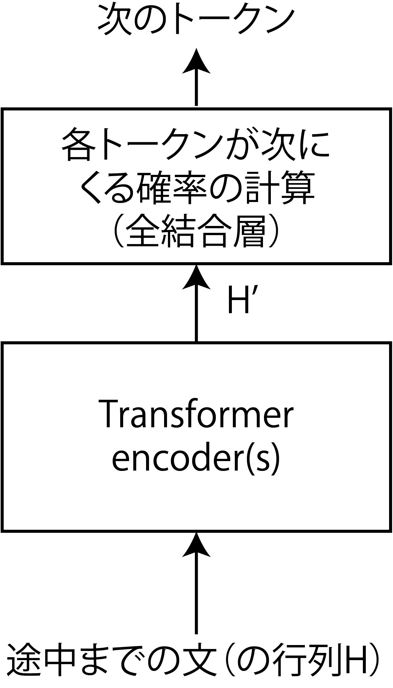

---

## まとめ

- Transformerエンコーダ
    - 埋め込みに文脈を反映
        - 位置情報の付加$\rightarrow$自己注意機構
- Transformerデコーダ
    - エンコーダの機能+交差注意機構で別の言語を文脈に反映可能
    - 学習の際にマスク
- その他の参考文献: [[菊田2025]](https://gihyo.jp/book/2025/978-4-297-15078-5)

---

- デコーダの場合は途中までの文を入力
    - `<SOS> I want to eat`など
        - （`<SOS>`: start of sentence）
- `<SOS>`から始めて、翻訳したものを次に入力に回す
    - 最初の入力: `<SOS>`
    - 次の入力: `<SOS> I`
    - 次の入力: `<SOS> I want`
    - ・・・と文ができていく
    （実際はエンコーダと同じく行列$E$を入力）

---

---

### 位置情報の追加

- DDPMで使ったもの（というよりTransformerでの使用のほうが歴史的に早い）
- エンコーダに入力する$E$の各トークンに、文章中での位置情報（位置符号）を付加
    - $H = \sqrt{D}E + P$
        - 位置情報: $P = [\boldsymbol{p}_1\ \boldsymbol{p}_2\ \dots\ \boldsymbol{p}_N]^\top$
- 位置情報のつけかたはDDPMのときの説明のとおり
    - 学習させる方法もある

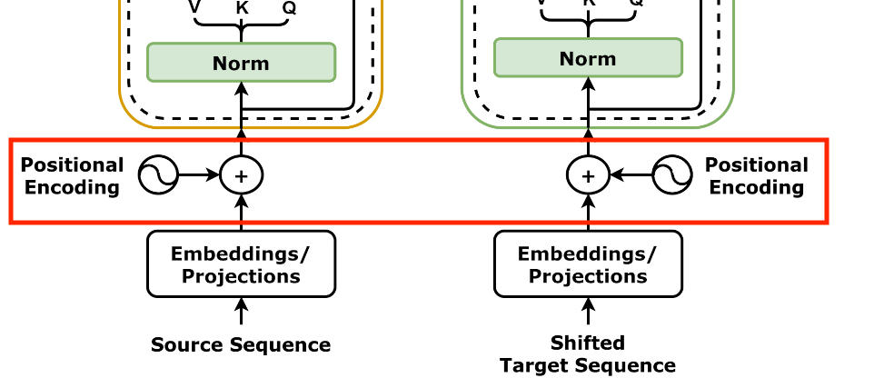

---

### 自己注意機構

- 自分自身の情報でトークンのベクトルを変える
    - 文脈が反映される（詳しくは次ページ）
- 仕組み: Q、K、Vをすべて自身への入力から作成
    - クエリ: $Q= W_\text{Q}H$$_\text{enc}$（前回は$H_\text{dec}$だった）
    - キー: $K= W_\text{K}H$$_\text{enc}$（同上）
    - バリュー: $V= W_\text{V}H_\text{enc}$
    - 出力: $H'=$Softmax$\Big(\dfrac{QK^\top}{\sqrt{D}}\Big)V$
- 前回の注意機構は交差注意機構

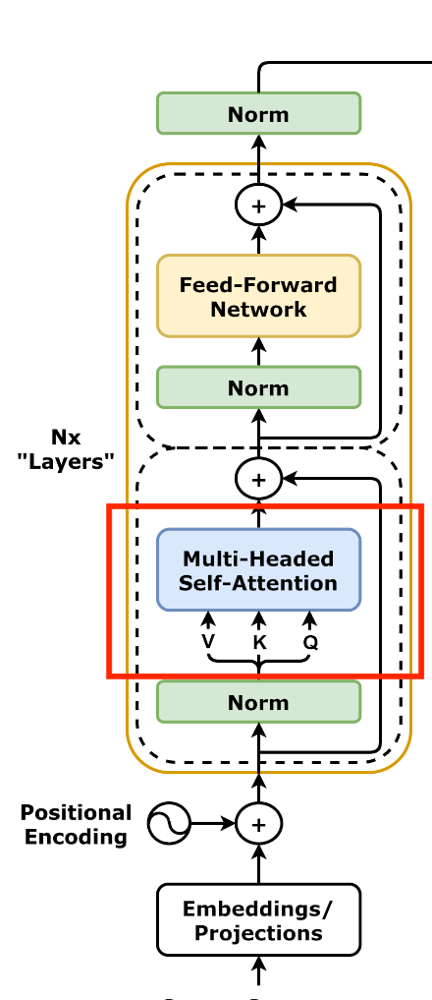

---

### 自己注意機構の補足[[Google2017]](https://research.google/blog/transformer-a-novel-neural-network-architecture-for-language-understanding/)

- 単に代名詞と名詞を関連づけるだけなら、
次の「it」は「dog」か「street」か分からない
    - 1: The animal didn't cross the street because it was too tired. 
        - it: dog
    - 2: The animal didn't cross the street because it was too wide.
        - it: street
- KVQ: クエリ（it）に対して、名詞だけではなく行列$K$で全てのトークンを作用させることで、itがどちらに近いかまでを計算可能に
    - "You shall know a word by the company it keeps!" [[Firth1957]](https://cs.brown.edu/courses/csci2952d/readings/lecture1-firth.pdf)（再掲）

---

### マルチヘッド注意機構

- Transformerの実装では注意機構が複数に分割される
    - $W_\text{K}, W_\text{V}, W_\text{Q}$（$D \times D$行列）が分割される
        - $Q^{(m)}= W_\text{Q}^{(m)}H$
        - $K^{(m)}= W_\text{K}^{(m)}H$
        - $V^{(m)}= W_\text{V}^{(m)}H\quad$（$m=1,2,\dots,M$）
            - $W_X^{(m)}$: $W_X$を横に切った$(D/M) \times D$行列
    - ANN的には、$m$ごとに結合が切れて独立
        - それぞれが文の解釈方法を変える
        （ように学習されるらしい）
- 出力の$Q^{(m)}, K^{(m)}, V^{(m)}$を結合$\rightarrow$元の$D \times D$行列に

